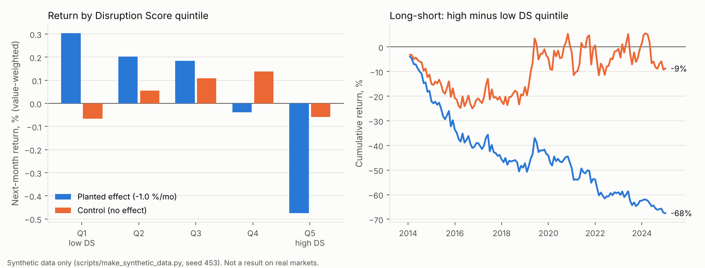

# The Disruption Score

**Does venture funding flowing into a public company's product space predict that company's stock returns?**

This repo contains a text-based measure that links each listed firm's 10-K business description to the private start-ups working on the same products, weights them by the money they raised last year, and tests the measure with a pre-registered asset-pricing design (portfolio sorts, Fama-MacBeth, placebo and block-bootstrap inference) that is built to avoid look-ahead bias.

> University group project (autumn 2026). This repository is my implementation of the data pipeline and the empirical tests. I wrote it with Claude Code as an AI pair-programmer.
> The study uses licensed data (CRSP/Compustat via WRDS, a Harmonic start-up export) that may not be redistributed. The repo therefore ships a **synthetic data generator** with the same file formats, so everything below runs end to end.



## Problem

Public-market investors see their listed competitors. It is much harder for them to see the venture-backed start-ups raising money to attack the same product space. If investor attention is limited, that information may not be fully in prices. A firm whose market is suddenly crowded with well-funded entrants might then earn lower future returns (a *threat*), or higher ones if the money signals a growing market (an *opportunity*).

## Approach

1. **Text similarity across the public–private boundary.** This extends Hoberg–Phillips text-based industries. TF-IDF vectors of each 10-K's *Item 1: Business* are compared with start-up descriptions by cosine similarity. The vocabulary and IDF are fitted on the **start-up corpus only**, and 10-Ks are projected into that fixed space.
2. **Disruption Score.** For each firm-month, take the k = 100 nearest start-ups above a similarity gate of 0.10 and sum the similarity-weighted funding they raised in the previous calendar year. There are four pre-registered variants: dollars (primary), change in dollars, round count, and dollars scaled by market cap.
3. **Tests, in a fixed order.** Value-weighted quintile sorts with a turnover cost haircut, then Fama-MacBeth on within-month ranks with Newey-West errors, then a shuffled-score placebo (200 draws) and a 12-month circular block bootstrap (2,000 draws). After that come a pre-declared subperiod split and industry-neutral (Fama-French 12) robustness checks.
4. **Look-ahead traps are enforced in code**, and each is commented where it applies (details in [`docs/METHOD.md`](docs/METHOD.md)):
   - a 10-K counts from the month after its filing date;
   - the start-up pool and IDF for year Y use only start-ups funded by Y−1;
   - funding comes from year Y−1;
   - ranks and portfolio breakpoints are computed within each month;
   - links between stocks and filings are point-in-time;
   - delisting returns are included.

The specification (k, gate, window, variants, primary test) was **pre-registered before the full corpus was scored** and is frozen in the code.

## Results

**On the licensed data**, the pre-registered primary test was a null result. Those numbers cannot be reproduced from this repository, so they are not quoted here.

**On synthetic data**, the repo checks that the pipeline recovers an effect when one exists and reports nothing when none does. `scripts/make_synthetic_data.py` builds 4,000 fake start-ups, 700 fake listed firms with 10-K texts, and monthly returns. In the default run, next-month returns contain a *planted* effect: −1.0 %/month per unit of a firm's true exposure rank. The control run sets the effect to zero.

Primary test (`ds_level_raw`, Fama-MacBeth with size control, 2014-01 to 2024-12, 132 months):

| Run | Planted effect | Estimate | t (Newey-West) | Block-bootstrap 95% CI | Placebo p |
|---|---|---|---|---|---|
| Planted effect | −1.00 %/mo | **−0.868 %/mo** | −4.11 | [−1.276, −0.469] | 0.000 |
| Control | 0 | −0.023 %/mo | −0.11 | [−0.440, +0.393] | 0.890 |

- In the planted run the pipeline recovers the sign and most of the size of the effect. The remaining gap is the expected attenuation: the score measures exposure with noise.
- In the control run the estimate is indistinguishable from zero, and the placebo test does not reject.
- The base-R implementation (`R/sorts_and_fm.R`) reproduces the planted-run numbers independently: Fama-MacBeth −0.869 %/mo (t = −4.11) and a quintile long-short of −0.778 %/mo (t = −2.82).
- The industry-neutral tests are weaker on synthetic data by construction. The planted exposure is mostly sector-level, so controlling for industry removes much of it.

Full logs: [`results/full_run_report.txt`](results/full_run_report.txt), [`results/control_no_effect/full_run_report.txt`](results/control_no_effect/full_run_report.txt) and [`results/r_output.txt`](results/r_output.txt). All runs are seeded and reproduce with the commands below.

## Tech stack

- **Python:** pandas, NumPy, SciPy sparse matrices, scikit-learn (TF-IDF, cosine similarity) and matplotlib. Versions are pinned in `requirements.txt`, which needs Python 3.11+.
- **R:** base R only. Sorts, Fama-MacBeth and the Newey-West estimator are written out by hand.
- **Data engineering:** a resumable SEC EDGAR client (`src/edgar_item1.py`) with rate limiting and three-way Item 1 extraction, which records the method used. It also handles point-in-time CRSP–EDGAR linking.

## How to run

```bash
python3 -m venv .venv && source .venv/bin/activate
pip install -r requirements.txt

python scripts/make_synthetic_data.py                    # ~10 s, writes data/
python src/full_run.py                                   # ~2 min, writes results/
Rscript R/sorts_and_fm.R results/tables/panel_for_R.csv  # optional: the same tests in base R

# control run without a planted effect, then the figure
python scripts/make_synthetic_data.py --effect 0 --out data_control
DS_DATA=data_control DS_OUT=results/control_no_effect python src/full_run.py
python scripts/make_figures.py
```

To run on the real data, put the licensed inputs in the same layout and point `DS_DATA` at them. See [`docs/DATA.md`](docs/DATA.md).

## Layout

```
src/full_run.py          the whole pipeline: text -> score -> panel -> tests
src/edgar_item1.py       SEC EDGAR 10-K Item 1 downloader/extractor (needs SEC_UA)
R/sorts_and_fm.R         sorts and Fama-MacBeth in base R
scripts/                 synthetic data generator, README figure
docs/METHOD.md           specification and the look-ahead traps
docs/DATA.md             real data sources and the expected file schema
results/                 logs, summary tables and the figure from the synthetic runs
data/                    not in git (generated or licensed)
```

## License

MIT for the code (see `LICENSE`). No third-party data is included.
